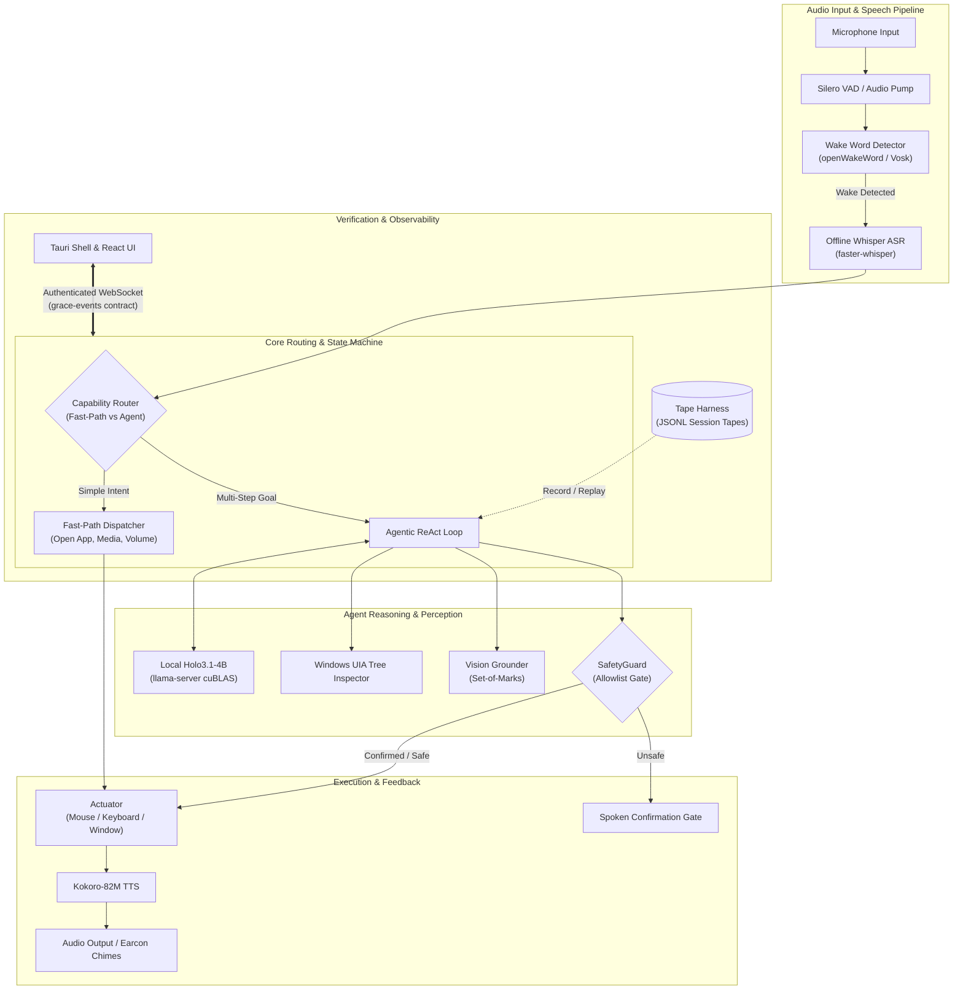

# Grace — Offline Voice Accessibility Assistant for Windows

Grace is a fully offline, local Windows voice agent engineered for people with motor dysfunction (such as ALS, cerebral palsy, spinal cord injuries, or severe tremors). While existing tools like Windows Voice Access and Dragon rely on rigid, memorized command grammars ("click button 3", "press enter twice"), Grace understands plain, conversational speech and autonomously plans, executes, and verifies multi-step computer tasks directly on the user's desktop—without sending a single byte of audio, text, or screen captures to the cloud.

---

## 30-Second Quickstart

### Prerequisites
- Windows 10 or 11 (64-bit)
- Python 3.11+
- NVIDIA GPU with 8 GB+ VRAM (for the buildathon interim model; e.g. GeForce RTX 4060)
- Optional: Rust toolchain (1.75+) and Node.js 18+ (to build the native Tauri shell)

### Setup
1. Clone the repository:
   ```cmd
   git clone https://github.com/IronManRox228228/Grace.git
   cd Grace
   ```
2. Create and activate a Python virtual environment:
   ```cmd
   python -m venv venv
   .\venv\Scripts\activate
   pip install -r requirements.txt
   ```
3. Copy `.env.example` to `.env`:
   ```cmd
   copy .env.example .env
   ```

### Required Model Files
Grace runs entirely offline. Download the required model weights manually and place them on your system (e.g. in `C:\Users\<User>\Downloads\` or a dedicated `models\` directory), then update your `.env` paths:

| Model / Asset | Role | Source / Hugging Face Repo | File Name | Size |
|---|---|---|---|---|
| **Holo3.1-4B-Instruct** | Unified LLM (intent, planning, vision grounding, tool calling) | `Holo-AI/Holo3.1-4B-Instruct-GGUF` | `Holo3.1-4B-Instruct-Q4_K_M.gguf` | ~2.5 GB |
| **Holo3.1-4B mmproj** | Multimodal projector for vision grounding | `Holo-AI/Holo3.1-4B-Instruct-GGUF` | `mmproj-Holo3.1-4B-Instruct-f16.gguf` | ~600 MB |
| **Whisper Base.en** | Local speech-to-text (ASR) | `Systran/faster-whisper-base.en` | Bundled / cached via `faster-whisper` | ~140 MB |
| **openWakeWord / Vosk** | Offline wake word ("Grace") | Pre-trained openWakeWord models | `grace.onnx` or small Vosk English model | ~45 MB |
| **Kokoro-82M** | Local text-to-speech (TTS) | `hexgrad/Kokoro-82M` | `kokoro-v0_19.onnx` + `voices.json` | ~320 MB |
| **llama-server** | High-performance local inference binary | `ggerganov/llama.cpp` releases | `llama-server.exe` (cuBLAS/CUDA build) | ~50 MB |

Configure `.env` with:
```env
LLAMA_SERVER_EXE=C:\Users\<User>\llama.cpp\llama-server.exe
LLAMA_MODEL_PATH=C:\Users\<User>\Downloads\Holo3.1-4B-Instruct-Q4_K_M.gguf
LLAMA_MMPROJ_PATH=C:\Users\<User>\Downloads\mmproj-Holo3.1-4B-Instruct-f16.gguf
USE_CLOUD_LLM=false
```

### Run

#### Primary Path (Native Rust Backend + Tauri Overlay Shell, Default)
Build and run Grace directly using Cargo:
```cmd
cargo run -p grace-shell
```
The shell automatically starts the high-performance Rust backend sidecar (`grace-backend.exe`) supervised inside a Windows Job Object (`JOB_OBJECT_LIMIT_KILL_ON_JOB_CLOSE`) with automatic health-watch and recovery.

To run the headless Rust backend sidecar directly without the UI overlay:
```cmd
cargo run -p grace-backend --bin grace-backend
```

#### Legacy Python Backend (Deprecated)
The Python backend remains selectable for one release cycle:
```cmd
set GRACE_BACKEND=python
cargo run -p grace-shell
```
Or run the Python entrypoint directly:
```cmd
python -m grace.main
```

#### Parity Verification Gate
To verify cross-backend parity and run both test suites:
```powershell
powershell -File scripts/parity.ps1
```

Say: *"Grace, open Notepad and write my appointment at 3 PM."*

---

## What Works Today vs. What Doesn't

### What Works Today
- **100% Offline Execution:** Complete end-to-end pipeline (wake word → Whisper ASR → Holo3.1-4B LLM → UI Automation / Actuator → Kokoro TTS) runs locally on the machine with zero cloud connectivity.
- **Dual-Path Capability Router:** Simple requests (app launches, volume, time, undo) route to instantaneous deterministic handlers (<300 ms) without LLM latency; complex instructions route to the ReAct agent loop.
- **Hybrid Grounding:** Inspects native Windows UI Automation (UIA) accessibility control trees first; falls back to vision grounding with Set-of-Marks visual tags for non-standard controls.
- **Voice Stop Reflex:** Immediate interruptibility (<500 ms) via continuous wake-word cancel watch during active planning, actuation, or speech output.
- **Safety Confirmations:** Irreversible or high-risk actions (`delete_file`, `close_app`, `lock_computer`) pause execution and demand clear spoken confirmation.
- **Deterministic Tape Harness:** Every turn can be recorded to structured tapes (`events`, `prompts`, `transcripts`, `actions`, `timings`) and verified via bit-exact replay testing.

### What Doesn't (Honest Limits & Ongoing Work)
- **GPU Requirement (Interim Model):** The current buildathon implementation uses Holo3.1-4B, requiring an NVIDIA GPU with ~8 GB VRAM. A sub-1B micromodel fleet running on the CPU floor is planned post-buildathon.
- **Atypical / Dysarthric Speech Personalisation:** ASR currently uses standard Whisper and Vosk models. Speech adaptation on dysarthric datasets (e.g. TORGO) is scheduled for Phase 2.
- **Physical Switch Inputs:** Switch and puff-and-sip inputs are currently mapped through Windows keyboard accessibility emulation rather than direct hardware serial drivers.

---

## Safety Architecture in Five Bullets

1. **Explicit Allowlist Confirmations:** Destructive actions (`delete_file`, `close_app`, `lock_computer`, `shutdown`) are blocked by `SafetyGuard` until the user verbally confirms approval. Unclear or mumbled replies trigger clarification rather than assumption.
2. **Untrusted-Data Quarantine:** Desktop content (window titles, web text, file contents) is quarantined within rigid boundary markers (`<<<UNTRUSTED_DATA_START ...>>>`) to neutralize prompt injection attacks.
3. **Instant Voice Stop Reflex:** The microphone stream remains open during task execution. Saying "Grace stop" or "cancel" immediately halts mouse/keyboard actuation and cancels speech within 500 ms.
4. **Airgap Offline Guarantee:** Grace defaults to `USE_CLOUD_LLM=false` and requires no network interface. The local WebSocket server is secured with per-launch cryptographic tokens and strict Origin allowlists.
5. **Memory Encryption & Pinned Binaries:** Long-term facts are stored locally using Windows DPAPI encryption at rest, sensitive tokens are redacted from logs, and external binaries (`llama.cpp`) require SHA-256 integrity verification.

---

## Architecture Diagram



---

## Roadmap

1. **The Micromodel Fleet (PLAN §3):** Replace the single 4B model with a specialized, sub-1B fleet running on the CPU floor (Intel Core i5 without dGPU, 8 GB RAM):
   - ASR: Parakeet-TDT 0.6B (int8 ONNX)
   - Tool calling: LFM2.5-350M fine-tune
   - Element selection: GLiNER2.5-Decide (340M)
   - Vision grounding: LFM2.5-VL-450M
   - Decision heads: Contrastive InfoNCE decision projections
2. **Speech Personalisation (PLAN §6):** Acoustic fine-tuning and evaluation on the TORGO dysarthria benchmark dataset to achieve high-accuracy speech recognition for atypical speech.
3. **Pure Rust Port (PLAN §11):** Transition the backend from Python to the native Rust crates (`crates/grace-core`, `crates/grace-win`, `crates/grace-memory`, `crates/grace-backend`), packaging Grace as a single, lightweight binary with zero Python dependencies.

---

## Verification & Testing

Grace maintains strict automated regression test suites across Python, Rust, and Frontend:
- **Python Backend:** `1008 passed, 1 skipped` (`pytest`)
- **Rust Crates:** `65 passed, 3 ignored` (`cargo test --workspace`)
- **Frontend Renderer:** `65 passed` (`npm run test`)
- **Preflight Checks:** `14/14 checks passed` (`python scripts/demo_check.py`)
- **Deterministic Replay Gate:** 100% pass on 35+ recorded corpus and demo tapes.
