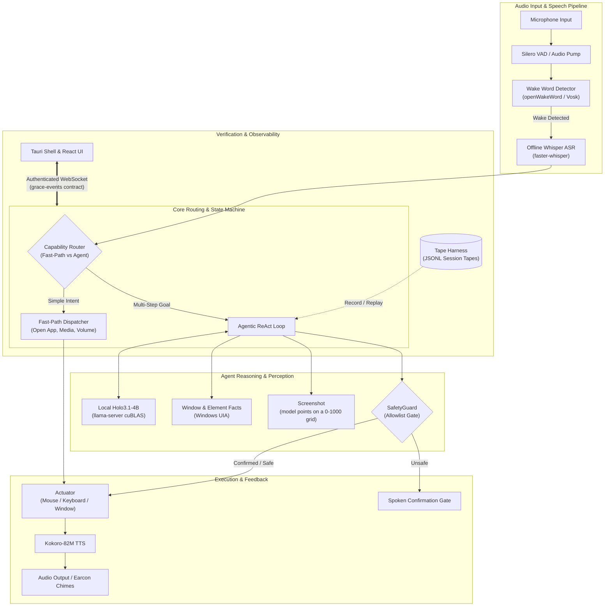

# Grace — Offline Voice Accessibility Assistant for Windows

Grace is a fully offline, local Windows voice agent engineered for people with motor dysfunction (such as ALS, cerebral palsy, spinal cord injuries, or severe tremors). While existing tools like Windows Voice Access and Dragon rely on rigid, memorized command grammars ("click button 3", "press enter twice"), Grace understands plain, conversational speech and autonomously plans, executes, and verifies multi-step computer tasks directly on the user's desktop—without sending a single byte of audio, text, or screen captures to the cloud.

---

## 30-Second Quickstart

### Prerequisites
- Windows 10 or 11 (64-bit)
- Python 3.11+
- NVIDIA GPU with 8 GB+ VRAM (for the buildathon interim model; e.g. GeForce RTX 4060)
- Optional: Rust toolchain (1.75+) and Node.js 18+ (to build the native Tauri shell)

### Setup
1. Clone the repository:
   ```cmd
   git clone https://github.com/IronManRox228228/Grace.git
   cd Grace
   ```
2. Create and activate a Python virtual environment:
   ```cmd
   python -m venv venv
   .\venv\Scripts\activate
   pip install -r requirements.txt
   ```
3. Copy `.env.example` to `.env`:
   ```cmd
   copy .env.example .env
   ```

### Required Model Files
Grace runs entirely offline. Download the required model weights manually and place them on your system (e.g. in `C:\Users\<User>\Downloads\` or a dedicated `models\` directory), then update your `.env` paths:

| Model / Asset | Role | Source / Hugging Face Repo | File Name | Size |
|---|---|---|---|---|
| **Holo-3.1-4B** | Unified LLM (intent, planning, vision grounding, tool calling) | Official `Hcompany/Holo-3.1-4B` is gated — use the ungated quant mirror `prithivMLmods/Holo-3.1-4B-GGUF` | `Holo-3.1-4B.Q4_K_M.gguf` | ~2.9 GB |
| **Holo-3.1-4B mmproj** | Multimodal projector for vision grounding | `prithivMLmods/Holo-3.1-4B-GGUF` | `Holo-3.1-4B.mmproj-q8_0.gguf` | ~350 MB |
| **Whisper small** | Local speech-to-text (ASR) | `Systran/faster-whisper-small` (set by `WHISPER_MODEL_PATH`) | Cached via `faster-whisper` | ~480 MB |
| **Vosk** (default) / openWakeWord | Offline wake word ("Grace") | Small Vosk English model | `vosk-model-small-en-us` | ~45 MB |
| **Kokoro-82M** | Local text-to-speech (TTS) | `hexgrad/Kokoro-82M` | `kokoro-v0_19.onnx` + `voices.json` | ~320 MB |
| **llama-server** | High-performance local inference binary | `TheTom's turboquant llama.cpp OR AtomicChat's turboquant llama.cpp` releases | `llama-server.exe` (cuBLAS/CUDA build) | ~50 MB |

Configure `.env` with:
```env
LLAMA_SERVER_EXE=C:\Users\<User>\llama.cpp\llama-server.exe
LLAMA_MODEL_PATH=C:\Users\<User>\Downloads\Holo-3.1-4B.Q4_K_M.gguf
LLAMA_MMPROJ_PATH=C:\Users\<User>\Downloads\Holo-3.1-4B.mmproj-q8_0.gguf
USE_CLOUD_LLM=false
```

### Run

#### Primary Path (Python Backend + Tauri Overlay Pill)
This is the path every recorded real run uses. It starts the UI dev server, then the Tauri shell with the Python backend, and saves a capture of each run to `runs/<timestamp>/`:
```powershell
powershell -ExecutionPolicy Bypass -File scripts/app_run.ps1
```
Or run the Python backend on its own, without the pill:
```cmd
python -m grace.main
```

#### Rust Backend (Port in Progress)
A Rust port of the backend (`grace-backend.exe`) runs under the same Tauri shell, supervised in a Windows Job Object. It does not yet have the agent changes the Python backend has.
```cmd
cargo run -p grace-backend --bin grace-backend
```
To check parity between the two backends:
```powershell
powershell -File scripts/parity.ps1
```

Say: *"Grace, open Notepad and write my appointment at 3 PM."*

---

## What Works Today vs. What Doesn't

### What Works Today
- **100% Offline Execution:** Complete end-to-end pipeline (wake word → Whisper ASR → Holo3.1-4B LLM → UI Automation / Actuator → Kokoro TTS) runs locally on the machine with zero cloud connectivity.
- **Dual-Path Capability Router:** Simple requests (app launches, volume, time, undo) route to instantaneous deterministic handlers (<300 ms) without LLM latency; complex instructions route to the ReAct agent loop.
- **Model Decides, Harness Obeys:** Each step, Holo-3.1-4B sees a screenshot of the screen plus short, plain facts (the active window, its own last steps and the element under each past click) and picks one action, pointing on a 0–1000 grid. Grace carries it out exactly. Grace never judges whether a step worked; only the model does. The harness blocks only harm.
- **Settle Before Looking:** After each action, Grace waits until the screen has stayed still for a full second before the next screenshot, so a loading page is not mistaken for a finished one.
- **Voice Stop Reflex:** Immediate interruptibility (<500 ms) via continuous wake-word cancel watch during active planning, actuation, or speech output.
- **Safety Confirmations:** Irreversible or high-risk actions (`delete_file`, `close_app`, `lock_computer`) pause execution and demand clear spoken confirmation.
- **Agent-Written User Memory:** Remembers what the user tells it (e.g. *"remember my usual song is Signal by Home"*, *"remember that I prefer Firefox"*), confirms verbally before saving, injects confirmed facts into intent and planner prompts (bounded to 8 facts, 600 chars, quarantined in untrusted data delimiters), and supports voice recall (*"What do you remember about me?"*) and hard deletion (*"Forget my name"*, *"Forget that I prefer Firefox"*, *"Forget everything"*). Provenance safety guarantees facts come exclusively from spoken words, never screens or documents, and stored facts can never override safety gates.
- **Deterministic Tape Harness:** Every turn can be recorded to structured tapes (`events`, `prompts`, `transcripts`, `actions`, `timings`) and verified via bit-exact replay testing.

### What Doesn't (Honest Limits & Ongoing Work)
- **High-End Hardware Acceleration:** While Grace runs on CPU-floor machines via the `"cpu-fleet"` micromodel architecture (sub-1B models, int8 ONNX, llama_cpp), ultra-low latency (<20 ms per token) benefits from modern NPU or iGPU hardware acceleration.
- **Physical Switch Hardware Integration:** Switch and puff-and-sip inputs are currently mapped through Windows keyboard accessibility emulation rather than direct hardware serial/USB drivers.
- **Small Targets:** Holo-3.1-4B tends to point on multiples of 5 on its 0–1000 grid, about 10 px on a 1920 px screen. Icons much smaller than that (for example Paint's 22 px toolbar tools) are often missed by a few pixels.
- **Wake Word:** The offline Vosk wake word sometimes hears "Grace" as similar words, or misses it.
- **UAC Prompt Approval (Known Limit):** By Windows operating system design, user-mode accessibility tools like Grace cannot reach or interact with the Windows Secure Desktop. Grace hands off UAC prompts and lock screens to Windows Voice Access.

---

## Accessibility Setup: Passwords & Windows Security Screens

### 1. Hands-Free Windows Security Screens & Voice Access
Grace coexists seamlessly with Windows Voice Access on a shared microphone:
- **Automatic Handoff:** When a UAC prompt, lock screen, or sign-in screen appears, Grace dispatches nothing, speaks a safe handoff line (*"That's a Windows security screen. Voice Access can handle it."*), and shows the exact Voice Access command phrases in the floating pill UI (*"Say 'voice access wake up', then 'click Yes' or 'click No'"*).
- **Grace Goes Deaf on Secure & Locked Screens:** For user privacy, Grace stops listening completely whenever the desktop is locked or secure so that spoken passwords never reach Grace.
- **Lock Screen Setup:** Verify with `grace.exe --check-setup`. To enable Voice Access before sign-in, tick *Settings → Accessibility → Speech → Voice access → "Start voice access before you sign in"*, or let Grace enable it via `grace.exe --enable-voice-access-at-signin` (approved hands-free via UAC).
- **Sign-In:** Windows Hello Face is recommended for hands-free sign-in. With Voice Access enabled before sign-in, saying *"hello"* dismisses the lock screen, allowing the user to speak their password.
- **Best Practice:** Keep Voice Access asleep during normal use (*"voice access sleep"*), and wake it only when security screens appear (*"voice access wake up"*).

### 2. Passwords Without Hands: Saved-Secret Vault
For users unable to type, Grace types saved passwords into verified fields without ever exposing credential values:
- **Caregiver Enrolment:** Passwords are enrolled securely by a caregiver via CLI: `grace.exe --save-secret <name> --site <domain-or-exe>`. Password entry is hidden and double-entered.
- **Zero Model Exposure:** In everything the planner sees, password fields appear only as `[password field, filled]` or `[password field, empty]`. Credentials never enter prompts, logs, or replay tapes.
- **Deterministic Phishing Guard:** When the user says *"type my gmail password"*, `type_saved_secret("gmail")` verifies at the millisecond of typing that the focused element is a password field and the active browser tab matches the registered eTLD+1 domain (rejecting lookalikes like `gmail.com.evil.io`).

---

## Safety Architecture in Five Bullets

1. **Explicit Allowlist Confirmations:** Destructive actions (`delete_file`, `close_app`, `lock_computer`, `shutdown`) are blocked by `SafetyGuard` until the user verbally confirms approval. Unclear or mumbled replies trigger clarification rather than assumption.
2. **Untrusted-Data Quarantine:** Desktop content (window titles, web text, file contents) is quarantined within rigid boundary markers (`<<<UNTRUSTED_DATA_START ...>>>`) to neutralize prompt injection attacks.
3. **Instant Voice Stop Reflex:** The microphone stream remains open during task execution. Saying "Grace stop" or "cancel" immediately halts mouse/keyboard actuation and cancels speech within 500 ms.
4. **Airgap Offline Guarantee:** Grace defaults to `USE_CLOUD_LLM=false` and requires no network interface. The local WebSocket server is secured with per-launch cryptographic tokens and strict Origin allowlists.
5. **Memory Encryption & Pinned Binaries:** Long-term facts are stored locally using Windows DPAPI encryption at rest, sensitive tokens are redacted from logs, and external binaries (`llama.cpp`) require SHA-256 integrity verification.

---

## Architecture Diagram



---

## Completed Milestones & v0.2.0 Roadmap

### Completed Milestones
1. **The Micromodel Fleet (PLAN §3):** Designed the sub-1B fleet architecture for CPU-floor machines (`"cpu-fleet"` preset). The buildathon build runs Holo-3.1-4B as a single model on a GPU (`"gpu-single"`); the fleet is the next step:
   - ASR: Parakeet-TDT 0.6B / Moonshine Base (int8 ONNX via sherpa-onnx)
   - Tool calling: LFM2.5-350M fine-tune / FunctionGemma 270M
   - Element selection: GLiNER2.5-Decide (340M) / Julia-1 (144M ONNX)
   - Vision grounding: LFM2.5-VL-450M Set-of-Marks
   - Decision heads: Contrastive InfoNCE decision projections
2. **Speech Personalisation (PLAN §6):** Acoustic evaluation on the TORGO dysarthria benchmark dataset, word biasing, correction list, and ongoing personal speech adaptation pipeline.
3. **Rust Port & Sidecar Split (PLAN §11):** A standalone Rust backend (`grace-backend.exe`) supervised by Tauri in a Windows Job Object with health-watch and recovery. The Python backend remains the primary one.
4. **Floor Latency Benchmarks (PLAN §9):** Hardware throttling kit (`tools/floor/`) and automated floor benchmark runner validating all sub-second latency budgets under severe memory and CPU constraints.

### Upcoming in v0.2.0
- The micromodel fleet in place of Holo-3.1-4B, for CPU-only laptops.
- Bring the Rust backend level with the Python agent.
- Direct USB/serial driver integration for physical switch accessibility hardware.
- Native MSI installer bundling the Tauri shell and Rust backend sidecar.

---

## Verification & Testing

Grace maintains strict automated regression test suites across Python, Rust, and Frontend:
- **Python Backend:** `1687 passed, 3 skipped` (`pytest`, 28 Oct 2026)
- **Rust Crates:** last recorded `289 passed, 3 ignored, 0 failed` (`cargo test --workspace`, per `PORT_STATUS.md`; not re-verifiable on this machine without the Rust toolchain)
- **Frontend Renderer:** `65 passed` (`npm run test`)
- **Preflight Checks:** `14/14 checks passed` (`python scripts/demo_check.py`)
- **Deterministic Replay Gate:** 100% pass on 30/30 recorded corpus tapes with exact event parity.
- **Parity Gate Script:** `powershell -File scripts/parity.ps1` runs both test suites and validates replay parity.
