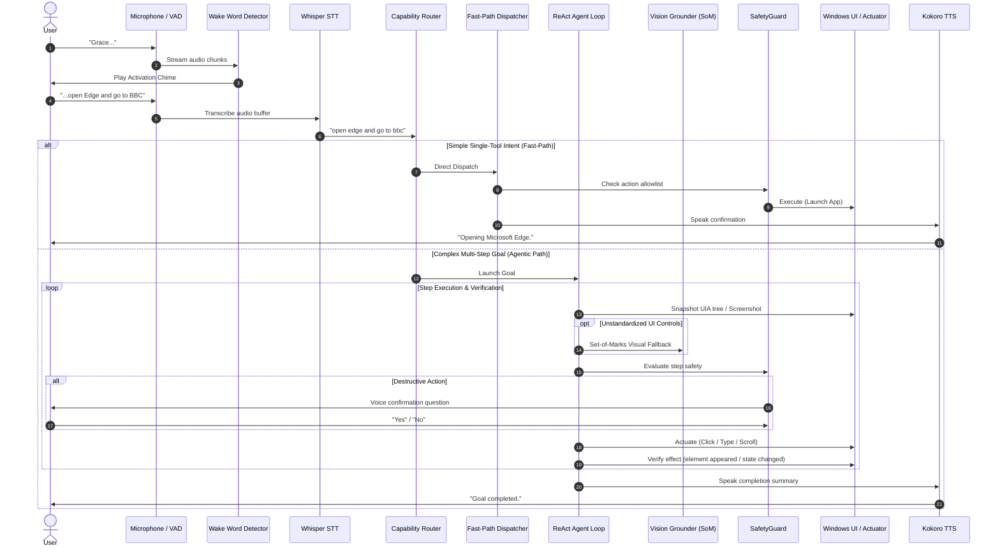

# Grace — System Architecture & Technical Design

This document details the architectural design of **Grace**, an offline, voice-controlled Windows accessibility assistant for users with severe motor disabilities. It covers the end-to-end processing pipeline, the module map across both Python and Rust implementations, the frozen event contract, and the deterministic tape harness.

---

## 1. High-Level Architectural Pipeline

Grace is built as a reactive, multi-stage state machine designed to minimize latency for common commands while providing deep, verified autonomous reasoning for complex desktop tasks.



---

## 2. Module Map (Python Default Runtime: `src/grace`)

The production backend is currently orchestrated in Python (`src/grace`):

| Module / Package | Path | Primary Responsibilities |
|---|---|---|
| **Core State Machine** | `src/grace/main.py` | `GraceApp` lifecycle, audio pump coordination, WebSocket event emission, watchdog supervision, and error recovery. |
| **Audio Processing** | `src/grace/audio/capture.py`<br>`src/grace/audio/pump.py`<br>`src/grace/audio/vad.py`<br>`src/grace/audio/wake_word.py` | PyAudio device capture, low-latency asynchronous audio queues, Silero VAD speech boundary detection, and openWakeWord / Vosk offline keyword detection with cancel watch. |
| **Speech Recognition** | `src/grace/speech/` | Offline Whisper transcription via `faster-whisper`, pre-warmed models, and audio normalisation. |
| **Routing & Tools** | `src/grace/intent/router.py`<br>`src/grace/intent/parser.py`<br>`src/grace/intent/tools.py`<br>`src/grace/tools/dispatcher.py` | `CapabilityRouter` separating simple commands from agent goals; JSON schema definitions for desktop tools; fast-path system dispatcher. |
| **Agentic Core** | `src/grace/agent/loop.py`<br>`src/grace/agent/planner.py`<br>`src/grace/agent/grounder.py`<br>`src/grace/agent/safety.py`<br>`src/grace/agent/perception.py` | ReAct step loop; structured plan generation with Holo3.1-4B; UI Automation element tree parsing; Set-of-Marks visual coordinate resolution; allowlist-based safety gate. |
| **Desktop Automation** | `src/grace/automation/actuator.py`<br>`src/grace/automation/app_indexer.py` | Native Windows mouse, keyboard, and window manipulation; safe Start Menu application discovery and resolution. |
| **Voice & Earcons** | `src/grace/response/generator.py`<br>`src/grace/response/feedback.py` | Kokoro-82M ONNX speech synthesis; dual-tone procedural earcons for listening, acknowledgement (<300 ms), cancellation, and error states. |
| **Security & Privacy** | `src/grace/agent/safety.py`<br>`src/grace/util/redact.py`<br>`src/grace/ws_server.py` | Delimited untrusted data boundaries; sensitive token redaction; Origin validation and per-session bearer token enforcement. |
| **Harness & Tapes** | `src/grace/harness/` | Session recorder, deterministic replay engine, tape diffing, and synthetic stub implementations. |

---

## 3. Module Map (Rust Native Port: `crates/`)

The ongoing Rust port (`crates/`) is designed to mirror the Python architecture behind the frozen contract, eventually yielding a single self-contained native executable:

| Crate | Path | Role & Ported Logic |
|---|---|---|
| `grace-contract` | `crates/grace-contract` | Strictly typed Rust data structures and Serde serializers generated from `contract/grace-events.schema.json`. |
| `grace-core` | `crates/grace-core` | Complete business logic: `CapabilityRouter`, `SafetyGuard`, `IntentParser`, `Planner`, `AgentLoop`, and `AppIndexer`. |
| `grace-models` | `crates/grace-models` | HTTP client communicating with local `llama-server` for text completion and multimodal vision grounding. |
| `grace-memory` | `crates/grace-memory` | Embedded SQLite + FTS5 episodic history and user fact store, encrypted at rest via Windows DPAPI. |
| `grace-win` | `crates/grace-win` | Native Win32 / UI Automation client, monitor DPI scaling, and SendInput simulation. |
| `grace-audio` | `crates/grace-audio` | Audio streaming abstractions and offline VAD interfaces. |
| `grace-harness` | `crates/grace-harness` | Bit-exact tape replay harness validating the Rust implementation against the recorded corpus tapes. |
| `grace-backend` | `crates/grace-backend` | Native Tokio-based WebSocket server serving the Tauri frontend. |
| `grace-shell` | `src-tauri` | Cross-platform desktop shell (Tauri v2) hosting the React accessibility interface. |

---

## 4. Frozen Event Contract (`contract/grace-events.schema.json`)

Communication between the Grace backend and the frontend user interface is strictly decoupled via a frozen JSON schema. The schema guarantees backward compatibility, allowing either Python or Rust to serve the React UI interchangeably.

### Transport Security & Authentication
- **Transport:** Local WebSocket (`ws://127.0.0.1:8765`).
- **Bearer Token Auth:** Every launch generates a cryptographically strong 32-byte URL-safe token passed via environment (`GRACE_WS_TOKEN`). Connections lacking this token are rejected.
- **Origin Filtering:** Handshakes must omit the `Origin` header (native desktop client) or match an explicit allowlist (`tauri://localhost`, `http://localhost:1420`).

### Core Event Hierarchy
Events emitted over the WebSocket include:

| Event Type | Direction | Payload Content | Purpose |
|---|---|---|---|
| `WakeWordDetected` | Backend → UI | `{ timestamp }` | Trigger listening animation and visual feedback. |
| `ListeningStarted` | Backend → UI | `{ timestamp }` | Display active microphone listening status. |
| `FinalTranscript` | Backend → UI | `{ text: string }` | Render the finalized speech transcript. |
| `UnderstandingStarted`| Backend → UI | `{ label: string }` | Indicate model intent analysis. |
| `AgentPlanCreated` | Backend → UI | `{ goal, steps: [...] }` | Render multi-step plan checklist in UI. |
| `AgentStepStarted` | Backend → UI | `{ step_index, description }` | Highlight active execution step. |
| `AgentStepFinished` | Backend → UI | `{ step_index, success }` | Mark step completed or failed. |
| `TurnTrace` | Backend → UI | `{ stages: [...], timing }` | Provide per-turn latency breakdown. |
| `Idle` | Backend → UI | `{ timestamp }` | Return interface to calm standby state. |

---

## 5. Deterministic Tape Harness & Replay Architecture

Testing computer-use voice agents is notoriously fragile due to hardware dependencies, timing variance, and dynamic desktop states. Grace solves this with a **hermetic recording and replay harness**.

### Tape Filesystem Layout
Each recorded scenario or demo session generates a self-contained tape directory:
```
corpus/
└── <scenario_name>/
    ├── meta.json          # Architecture metadata, model names, git commit
    ├── events.jsonl       # Exact WebSocket events emitted during the turn
    ├── transcripts.jsonl  # Raw user speech inputs and follow-ups
    ├── prompts.jsonl      # System and user prompts passed to the LLM
    ├── actions.jsonl      # Desktop automation commands dispatched
    └── timings.jsonl      # Stage durations and milestone timestamps
```

### Deterministic Replay Mechanism
During automated verification (`python -m grace.harness.replay` or `cargo test -p grace-harness`):
1. **ASR Stubbing (`_ScriptedASR`):** Replaces microphone input with the exact transcript from `transcripts.jsonl`.
2. **LLM Stubbing (`_ScriptedLLM`):** Validates that the generated prompts match `prompts.jsonl` byte-for-byte, then returns the prerecorded model completions.
3. **Actuator Stubbing (`_NullActuator`):** Intercepts OS commands (mouse clicks, key presses, app launches) and verifies that actions match `actions.jsonl` without touching the real desktop.
4. **Contract Verification:** Confirms that every emitted event conforms strictly to `contract/grace-events.schema.json`.
5. **Diff & Timing Analysis:** Compares timing profiles against a 50 ms scheduler jitter floor, alerting developers to regressions without failing on micro-tick variance.
